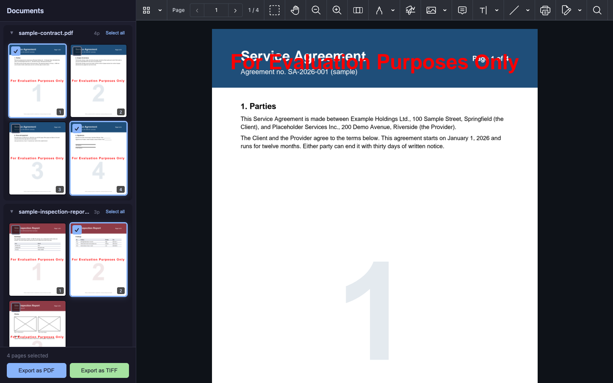
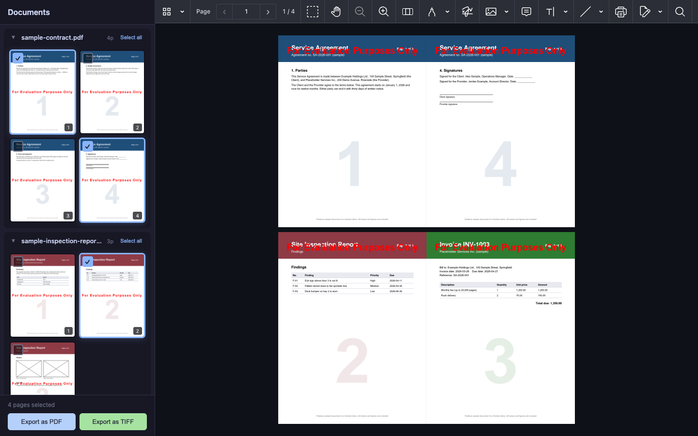

# Nutrient Multi-Document Page Selection

A Nutrient.io demo that lets you pick pages from several documents and combine them into one new PDF or TIFF.



*Pages selected across the sample documents, with the service agreement open in the viewer. All screenshots are taken in evaluation mode, so pages carry the evaluation mark.*

1. **Documents.** The ASP.NET Core server lists the PDF and TIFF files in `MultiDocPageSelection/Documents` and counts their pages with GdPicture.API.
2. **Thumbnails.** Each page is rendered to a PNG thumbnail on demand (`RenderPageToGdPictureImage`) and resized to the requested width.
3. **Selection.** The Angular 16 client shows every document with its page thumbnails. You select pages across as many documents as you need.
4. **Preview.** Clicking a PDF name opens it in the Nutrient Web SDK viewer.
5. **Export.** The client sends the list of selected pages to the server.
   - PDF pages are copied into a new PDF with `ClonePage`, so text and vector content are kept.
   - TIFF pages are drawn into the new PDF as images.
   - For a TIFF export, the new PDF is converted to a multipage LZW TIFF with `GdPictureDocumentConverter`.
   - Documents come in the order you first selected them; pages within a document are in page order.

## Prerequisites

- .NET SDK 10
- Node.js 18.10 or later and npm (tested with Node.js 22)
- Windows x64/x86, macOS, or Linux x64/ARM64 (the GdPicture.API native runtimes)

## Environment variables

Both variables are optional. Without them, the SDKs run in evaluation mode: the viewer shows a watermark and exported files carry an evaluation mark. Copy `.env.example` to `.env` to set them. Keys are only read from environment variables or `appsettings.json`, never from code.

| Variable | Purpose | Default |
|---|---|---|
| `GDPICTURE_LICENSE_KEY` | GdPicture.API license key used by the server | empty = evaluation mode |
| `NUTRIENT_WEB_LICENSE_KEY` | Nutrient Web SDK license key, served to the browser by `GET /api/config` | empty = evaluation mode |

## Build and run

Start the server on <http://localhost:5050>:

```bash
cp .env.example .env
```

```bash
cd MultiDocPageSelection
```

```bash
set -a && source ../.env && set +a && dotnet run --launch-profile http
```

On Windows, set a key in PowerShell before `dotnet run` if you have one:

```powershell
$env:GDPICTURE_LICENSE_KEY = "your-key"
```

```powershell
dotnet run --launch-profile http
```

In a second terminal, start the client on <http://localhost:4200>:

```bash
cd client
```

```bash
npm install
```

```bash
npm start
```

The Angular dev server proxies `/api` and `/documents` to the server on port 5050 (`client/proxy.conf.json`). The Web SDK is installed from the `@nutrient-sdk/viewer` npm package; `angular.json` copies its assets into the build, so no SDK files are stored in this repository. `npm run build` writes a production build to `client/dist/client`.

## Sample documents

`MultiDocPageSelection/Documents` holds three fictitious English PDFs: a four-page service agreement, three invoices and a three-page site inspection report. Every page shows a large page number so the thumbnails are easy to tell apart. They are generated by `tools/generate_samples.py`:

```bash
python3 -m venv .venv-samples
```

```bash
.venv-samples/bin/pip install reportlab
```

```bash
.venv-samples/bin/python tools/generate_samples.py
```

To use your own files, copy PDF or TIFF files into `MultiDocPageSelection/Documents` and reload the page.

## Using the app

1. Open <http://localhost:4200>. The left panel lists the documents with one thumbnail per page.
2. Click a document name to open it in the viewer on the right. Click the arrow to collapse or expand its pages.
3. Click thumbnails to select or clear pages. **Select all** and **Deselect all** work per document. The counter shows how many pages are selected.
4. Click **Export as PDF** or **Export as TIFF**. The browser downloads `export.pdf` or `export.tiff`.



*The `export.pdf` produced by the selection above: pages 1 and 4 of the service agreement, page 2 of the inspection report and page 3 of the invoices. The app downloads this file; for the screenshot it was opened in the viewer pane.*

## API

| Method and path | Description |
|---|---|
| `GET /api/documents` | `[{ id, fileName, pageCount }]` for each PDF and TIFF file in `Documents`, sorted by name |
| `GET /api/documents/{id}/pages/{page}/thumbnail?width=150` | PNG thumbnail of one page |
| `POST /api/export` | JSON `{ pages: [{ documentId, pageNumber }], format }` with `format` `pdf` or `tiff`; returns `export.pdf` or `export.tiff` |
| `GET /api/config` | `{ licenseKey }` for the Web SDK |
| `GET /documents/{fileName}` | The original file, loaded by the viewer |

`MultiDocPageSelection/MultiDocPageSelection.http` has ready-made requests for these endpoints.
